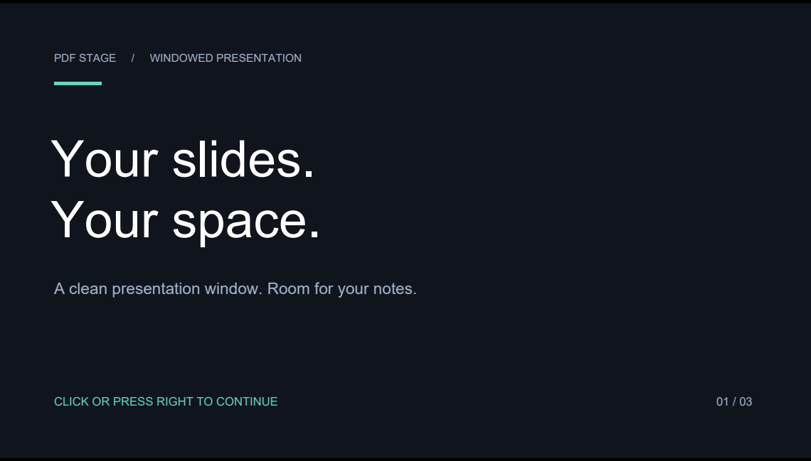

# PDF Stage

A borderless, resizable PDF presentation window for Windows. Present your slides in one part of the desktop and keep speaker notes beside them.

[中文完整说明](README.md) · [Download for Windows x64](https://github.com/xavier-xiao7/pdf-stage/releases/latest)



## The use case

During a Zoom presentation on a single monitor, open the slides in PDF Stage and your notes in another app. Resize the presentation window, then select that **individual application window** in Zoom's sharing picker. Keep your notes beside it. Optional global shortcuts let you turn pages while the notes window retains keyboard focus.

PDF Stage provides the presentation window; Zoom determines what is captured. Select a single window, prepare your document before sharing, and confirm the received view in a test meeting. Menus and dialogs may also be captured. Windows window capture has been tested; the receiving end of an actual Zoom meeting has not yet been verified.

Other uses include online teaching, technical walkthroughs, research talks and a clean document source for window recording. Export PowerPoint files to PDF first; animations and video are not supported.

## Quick start

1. Download `PdfStage-1.0.1-Windows-x64.zip` from [Releases](https://github.com/xavier-xiao7/pdf-stage/releases/latest).
2. Extract the whole ZIP and run `PdfStage.exe`. Keep `pdfium.dll` beside it.
3. Open or drop a PDF. Try the included `Demo.pdf` first.
4. Drag the page to move the window. Drag an edge or corner to resize it.
5. Press `Ctrl + 1` to fit the window to the page's aspect ratio.

Targets Windows 10/11 x64 with .NET Framework 4.8 or newer compatible runtime. Tested on Windows 11 x64. No installation, account or runtime internet connection is required. The release is unsigned.

## Controls

| Action | Input |
| --- | --- |
| Next page | Click, wheel down, Right, Down, Space, Page Down |
| Previous page | Shift-click, wheel up, Left, Up, Page Up, Backspace |
| First / last page | Home / End |
| Open / jump to page | Ctrl+O / Ctrl+G |
| Fit window to page | Ctrl+1 |
| Toggle always on top | Ctrl+T |
| Enable / disable global navigation | Ctrl+H |
| Global previous / next page | Ctrl+Alt+Left / Right, after enabling |
| Blackout / restore | B |
| Menu / help / exit | Right-click or Esc / F1 / Alt+F4 |

Ordinary navigation keys require focus. Global shortcuts are disabled on each startup. Pages retain their aspect ratio; mismatched windows have black bars. Borders embedded in the original PDF are preserved.

## Build and test

On Windows, from the repository root:

```powershell
powershell -NoProfile -ExecutionPolicy Bypass -File .\scripts\build.ps1
.\dist\PdfStage\PdfStage.exe .\examples\Demo.pdf
powershell -NoProfile -ExecutionPolicy Bypass -File .\scripts\package.ps1
```

The script uses the Windows .NET Framework C# compiler and fetches a pinned, SHA-256-verified PDFium build. Visual Studio is not required. Internet access is needed for the initial dependency download.

Tests also require Node.js on PATH and an interactive Windows desktop:

```powershell
powershell -NoProfile -ExecutionPolicy Bypass -File .\scripts\test.ps1
```

The tests temporarily open windows, move the pointer and send keyboard input. Do not operate the mouse or keyboard while they run. The verified 1.0.1 run contains 48 core checks and 18 menu checks, including 150 combined interaction cycles. See [validation details](docs/validation.md).

## Scope

PDF viewing only; no editing, OCR, annotations, embedded video playback, PDF JavaScript or XFA. Files are limited to 1 GB; rendered pages are capped at 4096 pixels per dimension. Password entry is supported, but not all encryption methods have been verified. Windows 10, mixed-DPI monitors and other conferencing tools need further end-to-end testing.

The application does not upload PDFs or include telemetry. Window geometry is saved to `%LOCALAPPDATA%\PdfStage\window.txt`. Exceptions are recorded in `errors.log` in the same directory; review exception text for personal file paths before posting it.

Version 1.0.1 fixes an early context-menu disposal that could terminate the application. See [CHANGELOG](CHANGELOG.md). The application uses C#, WinForms and PDFium on a serial render worker. See [third-party notices](THIRD_PARTY_NOTICES.md) for PDFium sources and bundled licenses. No open-source license has yet been selected for the original application code.
